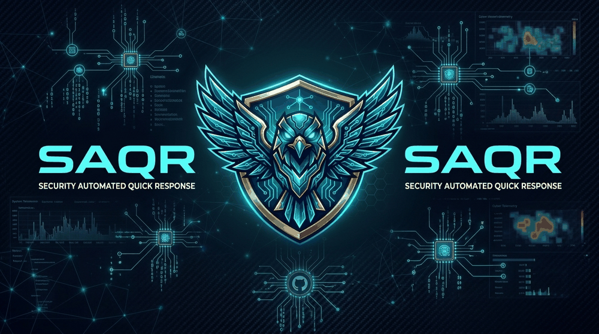
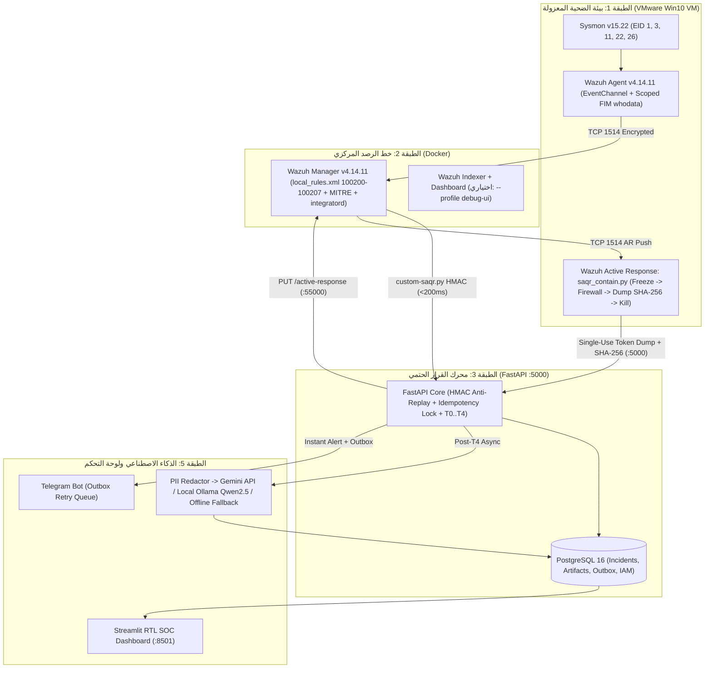

<p align="center">
  <a href="#-التشغيل-السريع-quickstart">
    
  </a>
</p>

<p align="center">
  <a href="#-التشغيل-السريع-quickstart"></a>
  <a href="#-المعمارية-خماسية-الطبقات"></a>
  <a href="#-طبقة-التقارير-العربية-الذكية-gemini-api--local-ollama"></a>
  <a href="#-وثائق-المشروع-والمرفقات"></a>
</p>

<p align="center">
  <b>منصة ذكية متكاملة للاستجابة الآلية للحوادث الأمنية بمركز عمليات مصغّر (Mini-SOC) ونواة استجابة حتمية (SOAR) مع طبقة تقارير عربية ذكية تعمل بعد اكتمال الاحتواء الحتمي.</b>
</p>
<p align="center">
  <i>Race-Free Containment · Volatile Memory Forensics (SHA-256) · Gemini API &amp; Local Ollama (Qwen2.5) · Deterministic MITRE ATT&amp;CK · Arabic RTL Dashboard</i>
</p>
<p align="center">
  <code>DETECT</code> &nbsp;•&nbsp; <code>CONTAIN</code> &nbsp;•&nbsp; <code>EXPLAIN</code>
</p>

---

> [!IMPORTANT]
> **القاعدة الذهبية لمنظومة صَقْر (The Golden Rule):**  
> الكشف والربط والاحتواء وحفظ الأدلة الجنائية (`SHA-256`) تُنفّذ **بقواعد حتمية 100%** دون انتظار أو تدخل الذكاء الاصطناعي؛ يعمل النموذج اللغوي (**Gemini API** أو **Local Ollama Qwen2.5** أو القالب العربي الاحتياطي دون إنترنت) **بعد اكتمال الاحتواء فقط** مع تنقيح إلزامي للبيانات الحساسة (**PII Redaction**).

---

## 🏛️ المعمارية خماسية الطبقات (متوافقة 100% مع المقترح المعتمد)



---

## 🔧 التحسينات الأمنية والمعمارية المدمجة

1. **إغلاق ثغرتي `CVE-2025-24016` و`CVE-2026-40106` وتقليص استهلاك RAM:** ترقية Wazuh من `v4.7.4` إلى **`v4.14.11`** ونقل `wazuh.indexer` و`wazuh.dashboard` إلى `--profile debug-ui` لتوفير **3–4GB RAM** على أجهزة 16GB.
2. **منع امتلاء القرص وتسريب البيانات وفقدان التنبيهات:** إزالة `report_changes="yes"` وSysmon EID `23` (`FileDelete` archiving)، وتفعيل EID `26` + EID `3` (SMB) + EID `22` (DNS) + PowerShell EID `4104` (Rule `100207`) + استثناءات `AppData`/`Temp` + رفع `<client_buffer>` إلى `25000 / 1000 EPS` + حصر `FIM whodata` في `Desktop/Documents/Downloads` و`C:\SAQR-Test`.
3. **إلغاء حالة السباق (Race Condition) وخطأ `Wrong-PID` في الاستجابة:** تنفيذ تسلسل حتمي داخل [`lab/vms/saqr_contain.py`](lab/vms/saqr_contain.py): **(1)** توجيه تنبيهات `vssadmin/wmic/wbadmin/bcdedit` إلى عملية الأب + قائمة عمليات محمية (`System`, `lsass.exe`, `svchost.exe`, `wazuh-agent.exe`, `Sysmon64.exe`) → **(2)** تجميد شجرة العمليات (`NtSuspendProcess`) → **(3)** عزل Windows Firewall مع إبقاء المنفذ `1514/1515` و`5000` وفصل SMB → **(4)** تفريغ الذاكرة (`MiniDumpWriteDump` / `procdump64.exe`) + `SHA-256` في خزنة `NT AUTHORITY\SYSTEM` ورفعه برمز استخدام لمرة واحدة → **(5)** إنهاء العملية + زر إلغاء العزل [`saqr_unquarantine.py`](lab/vms/saqr_unquarantine.py).
4. **ربط فوري موثّق بـ HMAC-SHA256 (`<200ms`):** عبر [`detection/wazuh/integrations/custom-saqr.py`](detection/wazuh/integrations/custom-saqr.py) مع حماية Anti-Replay بدلاً من استعلام OpenSearch كل 60 ثانية.
5. **إثبات عملي لـ `0` انتشار جانبي و`0%` إنذارات كاذبة:** حاوية [`samba-canary`](lab/vms/samba-canary/Dockerfile) خفيفة (`<64MB RAM`) تحوي 50 ملفاً موقّعاً بـ `SHA-256`، ومشغّل التجارب الـ 20 [`metrics/run_20_trials.py`](metrics/run_20_trials.py) الذي يختبر 20 هجمة + 20 نشاطاً سليماً.

---

## 🧠 طبقة التقارير العربية الذكية (Gemini API & Local Ollama)

توفّر [`engine/app/services/llm.py`](engine/app/services/llm.py) التوافق الكامل مع **كلا** الخيارين بمتغير بيئة واحد (`LLM_PROVIDER`):
- **`LLM_PROVIDER=gemini`:** استخدام **Gemini API** بعد تنقيح البيانات الحساسة إلزامياً في [`engine/app/services/redactor.py`](engine/app/services/redactor.py) وتغليف البيانات بوسم `<UNTRUSTED_TELEMETRY>` للحماية من Prompt Injection.
- **`LLM_PROVIDER=ollama`:** تشغيل نموذج محلي 100% دون إنترنت (`Qwen2.5` عبر `--profile local-llm`) تحقيقاً للهدف #3 في مقترح التخرج الموقّع.
- **`LLM_PROVIDER=offline` (أو عند انقطاع الإنترنت):** توليد تقرير عربي هيكلي فوري مع حفظ مهمة إعادة المحاولة في جدول `outbox_jobs` داخل PostgreSQL.

---

## 🛡️ السيناريوهات الدفاعية الثلاثة المدعومة

| السيناريو | المحاكاة | القواعد والربط الحتمي | الاستجابة المؤتمتة |
|---|---|---|---|
| 🔴 **برامج الفدية** (الفصل 1) | [`sim_ransom.py`](lab/attack-engine/ransomware-sim/sim_ransom.py) (`fast`, `shadowless`, `inplace`, `benign`) | قواعد `100200–100204`, `100207` (`T1486`, `T1490`, `T1021.002`) | تجميد → عزل Firewall → تفريغ ذاكرة `SHA-256` → إنهاء → تقرير عربي + Un-Quarantine |
| 🟡 **التصيد المستهدف** (الفصل 2) | [`sim_phishing.py`](lab/attack-engine/phishing-sim/sim_phishing.py) | قاعدة `100205` + كشف IDN/Homoglyph وSPF/DKIM/DMARC (`T1566.002`, `T1078`) | حظر النطاق (DNS Sinkhole) + إبطال فوري لجلسة JWT (`401`) |
| 🟠 **حجب الخدمة DDoS** (الفصل 2) | [`sim_ddos.py`](lab/attack-engine/ddos-sim/sim_ddos.py) (Botnet مقابل Flash Crowd) | قاعدة `100206` + تحليل إنتروبي `H(ip)` و`H(uri\|burst)` (`T1498`, `T1499`) | حظر عناوين IP المهاجمة (`403`) مع إبقاء الذروة الطبيعية (Flash Crowd) تعمل دون حظر (`200`) |

---

## 📁 هيكل المستودع (Monorepo)

```text
SAQR/
├── README.md
├── LICENSE
├── .env.example
├── .gitignore
├── docs/
│   ├── TEAM-HANDOFF-AND-DEFENSE-GUIDE.md   # دليل الفريق وأسئلة لجنة المناقشة
│   ├── OWNERSHIP-AGREEMENT-DRAFT.md        # مسودة اتفاقية الملكية المشتركة
│   └── brand/                              # الهوية البصرية والشعارات الرسمية
├── files/                                  # المقترح المعتمد والعرض التعريفي
│   ├── SAQR-Project-Explainer.pdf
│   └── Proposal/Project_Proposal_SAQR (1).pdf
├── deploy/
│   ├── docker-compose.yml                  # Wazuh v4.14.11 + PostgreSQL 16 + FastAPI + Streamlit + Ollama/Canary
│   ├── Dockerfile.engine
│   ├── Dockerfile.dashboard
│   └── wazuh/ossec.conf                    # إعدادات authd + integratord + أوامر Active Response
├── detection/
│   ├── sysmon/sysmonconfig-saqr.xml        # EID 1, 3, 11, 22, 26 (بلا EID 23 أو ضوضاء AppData)
│   └── wazuh/
│       ├── agent.conf                      # whodata + client_buffer 25000/1000 EPS (بلا report_changes)
│       ├── rules/local_rules.xml           # قواعد 100200-100207 مع وسوم MITRE ATT&CK حتمية
│       └── integrations/custom-saqr.py     # Webhook فوري موقّع بـ HMAC-SHA256
├── engine/
│   ├── db/schema.sql                       # مخطط PostgreSQL 16 مع قفل Idempotency ومنع التكرار
│   └── app/
│       ├── main.py                         # FastAPI Core (:5000)
│       ├── correlator.py                   # محرك الربط الحتمي للسيناريوهات الثلاثة
│       ├── database.py                     # PostgreSQL 16 (Docker) + SQLite WAL (للاختبار المحلي)
│       └── services/                       # soar.py, redactor.py, llm.py, telegram.py
├── dashboard/
│   └── app.py                              # لوحة تحكم Streamlit RTL العربية (:8501) مع زر Un-Quarantine
├── lab/
│   ├── vms/                                # win10-setup.ps1, saqr_contain.py, saqr_unquarantine.py, samba-canary/
│   └── attack-engine/                      # ransomware-sim/, phishing-sim/, ddos-sim/
├── metrics/
│   └── run_20_trials.py                    # مشغّل التجارب الـ 20 ومولّد جداول التقييم العلمي
└── tests/
    └── test_saqr_rework.py                 # اختبارات التكامل والأمان الشاملة (7/7)
```

---

## 🚀 التشغيل السريع (Quickstart)

### 1. تجهيز ملف المتغيرات وتشغيل الحاويات (WSL2 / Docker Desktop)
```bash
cp .env.example .env
# عدّل القيم في .env (كلمات المرور + مفتاح Gemini أو Ollama)

# التشغيل الخفيف الموصى به للعروض والتجارب (يوفر 3-4GB RAM على أجهزة 16GB):
docker compose -f deploy/docker-compose.yml up -d --build

# (اختياري) تشغيل Wazuh Dashboard أثناء تطوير القواعد فقط:
docker compose -f deploy/docker-compose.yml --profile debug-ui up -d

# (اختياري) تشغيل النموذج المحلي Ollama (Qwen2.5) لتلبية الهدف #3 دون إنترنت:
docker compose -f deploy/docker-compose.yml --profile local-llm up -d
docker exec saqr-ollama ollama pull qwen2.5:7b-instruct-q4_K_M

# (اختياري) تشغيل Samba Canary لإثبات 0 انتشار جانبي عملياً:
docker compose -f deploy/docker-compose.yml --profile canary up -d
```

### 2. إعداد آلة الضحية (`win10-vm` في VMware Workstation — Host-Only VMnet)
1. ثبّت **Wazuh Agent v4.14.11** واربطه بالخادم.
2. شغّل [`lab/vms/win10-setup.ps1`](lab/vms/win10-setup.ps1) بصلاحية Administrator لتطبيق `sysmonconfig-saqr.xml`، وتفعيل PowerShell EID `4104`، وتجهيز خزنة الأدلة `C:\ProgramData\SAQR\Vault` (صلاحية `SYSTEM` فقط)، وتثبيت `saqr-contain.cmd` و`saqr-unquarantine.cmd`، ومزامنة الوقت.

### 3. التحقق والاختبارات الآلية والتجارب الـ 20
```bash
# تشغيل اختبارات النظام والأمان الكاملة محلياً بدون الحاجة لـ VMware:
PYTHONPATH=engine:. python3 -m unittest discover -s tests -v

# تشغيل بروتوكول التجارب الـ 20 (وضع المحاكاة السريعة أو وضع VMware):
python3 metrics/run_20_trials.py --mode simulate
```

---

## 📄 وثائق المشروع والمرفقات

* 📘 **[دليل الفريق ولجنة المناقشة (TEAM-HANDOFF-AND-DEFENSE-GUIDE.md)](docs/TEAM-HANDOFF-AND-DEFENSE-GUIDE.md):** شرح الإصلاحات الـ 7، توزيع أدوار الفريق الخمسة، وإجابات أسئلة لجنة المناقشة.
* 📊 **[SAQR-Project-Explainer.pdf](files/SAQR-Project-Explainer.pdf):** العرض البصري التعريفي بالمنصة والقواعد الهندسية الذهبية.
* 📝 **[Project_Proposal_SAQR.pdf](files/Proposal/Project_Proposal_SAQR%20(1).pdf):** المقترح الأكاديمي المعتمد لمشروع التخرج.
* 🎨 **[Official Brand Assets](files/saqr-banner.png):** الهوية البصرية الرسمية للمنصة — [الشعار الكامل](files/saqr-banner.png) | [أيقونة التطبيق](files/saqr-icon.png) | [رمز الشعار](files/saqr-logo.png).

---

<p align="center">
  <b>صُمم وطُوّر كمنصة سيبرانية دفاعية خاصة بمشروع SAQR 🦅</b>
  <br />
  <sub>مشروع أكاديمي مملوك بصورة مشتركة لأعضاء فريق SAQR الخمسة. جميع الحقوق محفوظة. راجع ملف LICENSE.</sub>
  <br />
  <sub>SAQR — Security Automated Quick Response © 2026</sub>
</p>
