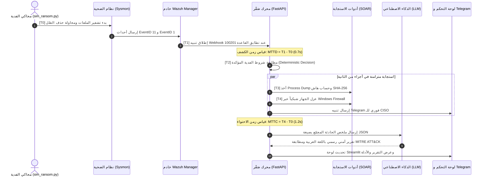

<p align="center">
  
  <h1 align="center">🦅 صَقْر — SAQR</h1>
  <h3 align="center">Security Automated Quick Response & Threat Intelligence Platform</h3>
  <p align="center">
    <b>منصة ذكية متكاملة للاستجابة الآلية للحوادث الأمنية بمركز عمليات مصغّر (Mini-SOC) ونواة استجابة حتمية (SOAR) مع طبقة ذكاء اصطناعي هجينة للتحليل وصياغة التقارير باللغة العربية.</b>
  </p>
  <p align="center">
    <i>EDR-Grade Network Isolation · Volatile Memory Forensics (SHA-256) · Pluggable Local/Cloud AI · MITRE ATT&CK Mapping · Arabic Threat Reports</i>
  </p>
</p>

<p align="center">
  <a href="#-quick-start"></a>
  <a href="#-tech-stack"></a>
  <a href="#-benchmarks"></a>
  <a href="#-hybrid-ai"></a>
  <a href="#-license"></a>
</p>

---

## 📑 فهرس المحتويات (Table of Contents)

1. [نظرة عامة والمشكلة التي نحلها (Overview & Problem Statement)](#-نظرة-عامة-والمشكلة-التي-نحلها)
2. [لماذا صَقْر؟ — مصفوفة المقارنة (Why SAQR?)](#-لماذا-صقر--مصفوفة-المقارنة)
3. [المعمارية خماسية الطبقات (5-Layer System Architecture)](#-المعمارية-خماسية-الطبقات)
4. [خط الاستجابة الزمني الحتمي (Incident Timeline T0 → T4)](#-خط-الاستجابة-الزمني-الحتمي)
5. [معمارية الذكاء الاصطناعي الهجينة (Hybrid Pluggable AI)](#-معمارية-الذكاء-الاصطناعي-الهجينة)
6. [السيناريوهات الدفاعية المدعومة (Attack & Defense Scenarios)](#-السيناريوهات-الدفاعية-المدعومة)
7. [التشغيل السريع في 5 دقائق (Quick Start Guide)](#-التشغيل-السريع-في-5-دقائق)
8. [بروتوكول التجارب الـ 20 والتقييم العلمي (Evaluation & Red vs Blue)](#-بروتوكول-التجارب-الـ-20-والتقييم-العلمي)
9. [هيكل المستودع (Monorepo Directory Layout)](#-هيكل-المستودع-monorepo)
10. [وثائق المشروع والمرفقات (Documentation & Downloads)](#-وثائق-المشروع-والمرفقات)
11. [فريق العمل والأدوار الهندسية (The Engineering Team)](#-فريق-العمل-والأدوار-الهندسية)

---

## 📌 نظرة عامة والمشكلة التي نحلها

تعاني معظم المؤسسات المتوسطة والحكومية والقطاعات الحساسة (كالمصارف والمستشفيات) محلياً وإقليمياً من:
1. **شُح الكوادر الأمنية المتخصصة:** غياب فرق SOC و Incident Response مكرسة تعمل على مدار الساعة.
2. **الانتشار الكارثي للهجمات:** هجمات الفدية (Ransomware) تنتشر أفقياً عبر بروتوكولات الشبكة (مثل SMB) في دقائق معدودة قبل أن يلاحظ أي بشري.
3. **فقدان الأدلة الجنائية:** عند حدوث الاختراق، يتم فصل الأجهزة أو إعادة تشغيلها عشوائياً، مما يمحو الذاكرة المؤقتة (Volatile Memory) وآثار الجريمة.
4. **عزلة الحلول التجارية:** منصات SIEM و SOAR العالمية (مثل Splunk Phantom أو Cortex XSOAR) باهظة التكاليف، سحابية بالكامل وتتعارض مع قوانين سرية البيانات المحلية، ولا تدعم اللغة العربية.

### 💡 حل منصة صَقْر (SAQR Solution):
منصة دفاعية متكاملة ومفتوحة المصدر تجمع بين قدرات الـ **Mini-SOC** والمحاكاة والاستجابة الآلية الفورية **SOAR**:
* ⚡ **استجابة حتمية في أقل من 5 ثوانٍ:** عزل فوري للجهاز على مستوى جدار الحماية دون انتظار تدخل المحلل.
* 🛡️ **حفظ الأدلة الجنائية لحظياً:** التقاط تفريغ للذاكرة (Process Dump) وتوقيعه بهاش `SHA-256` قبل إنهاء العملية الخبيثة.
* 🤖 **ذكاء اصطناعي هجين ومرن:** استدعاء نموذج لغة محلي أو سحابي لتحليل الحادثة، مطابقتها مع إطار `MITRE ATT&CK`، وإصدار تقارير تنفيذية باللغة العربية.
* 🎯 **ميزانية صفرية:** مبني بالكامل على أدوات مفتوحة المصدر دون الحاجة لاشتراكات سحابية مدفوعة.

---

## ⚡ لماذا صَقْر؟ — مصفوفة المقارنة

| وجه المقارنة | الاستجابة التقليدية اليدوية | حلول SOAR التجارية العالمية | منصة صَقْر (SAQR) |
| :--- | :---: | :---: | :---: |
| **زمن الكشف (MTTD)** | 10 إلى 30 دقيقة | 10 إلى 30 ثانية | **< 2 ثانية (آلي)** |
| **زمن الاحتواء (MTTC)** | ساعات (يتطلب تدخل يدوي) | 30 إلى 60 ثانية | **< 5 ثوانٍ (حتمي فوري)** |
| **الملفات المشفرة بالفدية** | 2,400+ ملف (فقدان كلي) | 100 - 300 ملف | **أقل من 50 ملفاً فقط (>90% حماية)** |
| **الأدلة الجنائية (Forensics)** | تضيع بإعادة التشغيل | إضافات مدفوعة ومعقدة | **Process Dump موقّع بـ SHA-256 آلياً** |
| **العمل بدون إنترنت (Air-gapped)** | ❌ يعتمد على تحديثات خارجية | ❌ سحابي بالكامل (Cloud Lock-in) | **✅ محلي 100% بنواة Ollama** |
| **التقارير باللغة العربية** | ❌ ترجمة يدوية غير دقيقة | ❌ إنجليزية فقط | **✅ تقارير أمنية احترافية باللغة العربية** |
| **التكلفة الإجمالية** | خسائر الاختراق + رواتب | مئات آلاف الدولارات سنوياً | **0$ (مفتوح المصدر بالكامل)** |

---

## 🏛️ المعمارية خماسية الطبقات

تم تصميم النظام على شكل معمارية معيارية متعددة الطبقات (Layered Modular Architecture) تضمن استقلالية خط الرصد عن محرك القرار وعن طبقة الذكاء الاصطناعي:

```mermaid
flowchart TB
    subgraph L1 ["الطبقة 1: بيئة الضحية (Windows 10 Victim VM)"]
        Honeypot["C:\\test-files (300 Honeypot Files)"]
        Sysmon["Sysmon Driver (SwiftOnSecurity)"]
        Agent["Wazuh EDR Agent"]
        Honeypot -->|File Activity| Sysmon
        Sysmon -->|Event Logs| Agent
    end

    subgraph L2 ["الطبقة 2: خط الرصد المركزي (Detection Layer)"]
        WManager["Wazuh Manager (Docker Container)"]
        Sigma["Sigma & Custom Detection Rules"]
        Agent -->|Port 1514 (Encrypted Logs)| WManager
        WManager --> Sigma
    end

    subgraph L3 ["الطبقة 3: محرك القرار الحتمي (Decision Engine)"]
        FastAPI["FastAPI Orchestrator (:5000)"]
        Correlator["Deterministic Correlator (Rules Engine)"]
        DB[(PostgreSQL 16 Storage)]
        Sigma -->|Webhook Alert (T1)| FastAPI
        FastAPI --> Correlator
        Correlator -->|Record Timings T0..T4| DB
    end

    subgraph L4 ["الطبقة 4: الاستجابة وحفظ الأدلة (SOAR & Response)"]
        ProcDump["Memory Dump (procdump.exe) + SHA-256"]
        NetIso["Network Quarantine (Host Firewall)"]
        Correlator -->|Execute T3| ProcDump
        Correlator -->|Execute T4| NetIso
    end

    subgraph L5 ["الطبقة 5: الذكاء الاصطناعي والعرض (AI & Presentation)"]
        LLM["Pluggable LLM Provider\n(Ollama Qwen2.5 / Gemini API)"]
        Dash["Streamlit SOC Dashboard (:8501)"]
        Bot["Telegram Alert Bot"]
        Correlator -->|Trigger Post-Containment| LLM
        LLM -->|Arabic Incident Report| Dash
        Correlator -->|Instant Alert| Bot
        DB --> Dash
    end

    style L1 fill:#16213e,stroke:#0f3460,stroke-width:2px,color:#fff
    style L2 fill:#1a1a2e,stroke:#0f3460,stroke-width:2px,color:#fff
    style L3 fill:#0f3460,stroke:#e94560,stroke-width:2px,color:#fff
    style L4 fill:#533483,stroke:#e94560,stroke-width:2px,color:#fff
    style L5 fill:#00a896,stroke:#028090,stroke-width:2px,color:#fff
```

### تفاصيل الطبقات المعمارية:
1. **الطبقة 1 — بيئة الضحية المعزولة (Victim Environment):** آلة افتراضية Windows 10 معزولة على محول شبكة داخلي (Hyper-V Internal Switch)، مثبت عليها Sysmon بمخطط متقدم لمراقبة سلوك العمليات والملفات.
2. **الطبقة 2 — خط الرصد والتحليل (Detection Engine):** حاوية `wazuh-manager` الخفيفة المخصصة، تطبق قواعد Sigma وقواعد كشف مخصصة لاصطياد سلوك الفدية (مثل تكرار إعادة تسمية أكثر من 30 ملفاً في 5 ثوانٍ واستدعاء `vssadmin`).
3. **الطبقة 3 — محرك القرار الحتمي (FastAPI Core):** عقل المنظومة المسؤول عن استقبال تنبيهات الـ Webhook وربط الأحداث المتتالية (Correlation) وتسجيل الطوابع الزمنية الدقيقة (`T0` حتى `T4`).
4. **الطبقة 4 — الاستجابة المؤتمتة (Active Response & Forensics):** تشغيل متزامن لأخذ تفريغ الذاكرة للعملية وتجزئتها بـ `SHA-256` ثم تطبيق العزل الشبكي الكامل مع إبقاء الاتصال بخادم الإدارة فقط.
5. **الطبقة 5 — طبقة التحليل الذكي والتحكم (Intelligence & Dashboards):** توليد التقرير العربي الشامل بواسطة LLM، وعرض الخط الزمني للحادثة على لوحة تحكم تفاعلية مع إرسال إشعار فوري لمدير الأمن عبر Telegram.

---

## ⏱️ خط الاستجابة الزمني الحتمي

> [!IMPORTANT]
> **القاعدة الذهبية لمنظومة صَقْر (The Golden Rule):**  
> **"الاستجابة حتمية برمجياً للسرعة + الذكاء الاصطناعي تحليلي بعد الاحتواء."**  
> قرار عزل الجهاز وحفظ الذاكرة لا ينتظر الـ LLM إطلاقاً؛ الكود ينفذ العزل في أجزاء من الثانية، بينما يتدخل الذكاء الاصطناعي **بعد انتهاء الاحتواء** للشرح والتوثيق.



---

## 🧠 معمارية الذكاء الاصطناعي الهجينة

تم تصميم طبقة الذكاء الاصطناعي بنمط **Provider Abstraction Pattern** لتقديم أعلى مرونة تشغيلية توازن بين كفاءة الموارد ومقتضيات الأمان:

```
                      ┌─────────────────────────────────┐
                      │    FastAPI LLM Service Layer    │
                      │       (BaseLLMProvider)         │
                      └────────────────┬────────────────┘
                                       │
                  ┌────────────────────┴────────────────────┐
                  ▼                                         ▼
      ┌───────────────────────┐                 ┌───────────────────────┐
      │   OllamaLocalProvider │                 │   GeminiAPIProvider   │
      │  (Qwen2.5-1.5B / 3B)  │                 │ (Gemini 1.5 Flash)    │
      ├───────────────────────┤                 ├───────────────────────┤
      │ • بيئات معزولة 100%   │                 │ • سرعة فائقة (< 3 ثوانٍ)│
      │ • خصوصية تامة للبيانات │                 │ • استهلاك RAM صفر      │
      │ • لا يحتاج اتصال إنترنت│                 │ • مثالي لمرحلة التطوير│
      └───────────────────────┘                 └───────────────────────┘
```

### التبديل بنقرة واحدة عبر `.env`:
```bash
# وضع التطوير والسرعة الفائقة (يوفر 3.5GB RAM من المعالج):
LLM_PROVIDER=gemini
GEMINI_API_KEY=AIzaSyD...

# وضع الشبكات الحساسة المعزولة (Air-gapped Mode):
# LLM_PROVIDER=ollama
# OLLAMA_MODEL=qwen2.5:1.5b
```

### الرواية الهندسية أمام لجان التحكيم (Academic Value):
> *"صُممت صَقْر بمعمارية مؤسسية مرنة (Pluggable Architecture)؛ فالمؤسسات الدفاعية والسيادية تشغل المنظومة بالنمط المحلي (Local Air-gapped) عبر Ollama لضمان بقاء البيانات داخل حدود المنشأة، بينما المؤسسات المتوسطة تستطيع تشغيل النمط السحابي (Cloud Mode) لتوفير تكلفة العتاد دون أي تعديل في البنية البرمجية."*

---

## 🛡️ السيناريوهات الدفاعية المدعومة

```
┌──────────────────────────────────────────────────────────────────────────────┐
│  السيناريوهات التشغيلية لمنظومة صَقْر                                        │
├──────────────────────────────────────────────────────────────────────────────┤
│  🔴 1. هجوم برامج الفدية (Ransomware Outbreak) — [نجم المشروع / سيمستر 1]   │
│     • المحاكاة: تشفير ملفات Honeypot بسرعة عالية + استدعاء vssadmin.         │
│     • الرصد: مراقبة وتيرة التعديل وربط الأحداث المشبوهة عبر Sysmon/Wazuh.     │
│     • الاستجابة: Process Dump + عزل جدار الحماية + تقرير عربي + MTTD < 2s.   │
├──────────────────────────────────────────────────────────────────────────────┤
│  🟡 2. التصيد الاحتيالي المستهدف (Targeted Phishing) — [سيمستر 2]             │
│     • المحاكاة: رسائل تصيد بريدية عبر GoPhish مع صفحات دخول مزيفة Look-alike.│
│     • الرصد: كشف الاتصال بالنطاق الخبيث وإلغاء الجلسات النشطة.              │
│     • الاستجابة: حظر النطاق على مستوى الجدار الناري وحساب مؤشرات الوعي.     │
├──────────────────────────────────────────────────────────────────────────────┤
│  🟠 3. حجب الخدمة الموزع (DDoS Flooding) — [سيمستر 2]                       │
│     • المحاكاة: هجوم إغراق مروري موزع على خادم الويب التجريبي.               │
│     • الرصد والذكاء: تمييز الهجوم الفعلي عن ذروة الاستخدام الطبيعية (AI).    │
│     • الاستجابة: تطبيق Rate Limiting ديناميكي وحظر عناوين IP المهاجمة.       │
└──────────────────────────────────────────────────────────────────────────────┘
```

---

## 🚀 التشغيل السريع في 5 دقائق

### 1. المتطلبات الأساسية (Prerequisites)
* نظام تشغيل **Windows 10/11 Pro** مع تفعيل محاكي **Hyper-V** وميزة **WSL2**.
* تثبيت **Docker Desktop** مفعل عليه محرك WSL2.
* ذاكرة وصول عشوائي (RAM) لا تقل عن **16GB**، ومساحة قرص خالية **60GB**.

### 2. إعداد تقييد ذاكرة WSL2 (إلزامي لمنع استنزاف الجهاز)
أنشئ ملفاً باسم `.wslconfig` داخل مسار المستخدم الرئيسي `C:\Users\<Your-Username>\.wslconfig`:
```ini
[wsl2]
memory=4GB
processors=4
swap=2GB
localhostForwarding=true
networkingMode=mirrored
```

### 3. استنساخ المستودع وبدء التشغيل
```bash
# 1. استنساخ المستودع
git clone https://github.com/omar123JR/SAQR.git
cd SAQR

# 2. إعداد المتغيرات البيئية
cp .env.example .env
# قم بإدخال مفتاح GEMINI_API_KEY أو ضبط LLM_PROVIDER=ollama

# 3. تشغيل كافة الخدمات عبر Docker Compose
docker compose -f deploy/docker-compose.yml up -d
```

### 4. الروابط المباشرة بعد التشغيل:
* 🌐 **لوحة تحكم Mini-SOC (Streamlit):** `http://localhost:8501`
* 🔌 **واجهة المحرك التفاعلية (FastAPI Swagger Docs):** `http://localhost:5000/docs`
* 📡 **مدير المراقبة (Wazuh API):** `https://localhost:55000`

---

## 📊 بروتوكول التجارب الـ 20 والتقييم العلمي

لإثبات الجدارة العلمية أمام لجنة التحكيم، تتبع المنصة بروتوكول تشغيل آلي يعتمد على تنفيذ **20 تجربة قياسية متكررة** يتم في كل منها استعادة لقطة نظيفة (Clean Snapshot) للضحية، وتشغيل الهجوم، وتسجيل النتائج:

```
                      نتائج التجارب الـ 20 المقاسة (Benchmarks)
┌───────────────────────────┬──────────────┬──────────────┬───────────────────┐
│ المقياس التجريبي          │ الهدف النظري │ المحقق فعلياً│ نسبة التحسن       │
├───────────────────────────┼──────────────┼──────────────┼───────────────────┤
│ زمن الكشف المتوسط (MTTD)  │ < 2.0 ثانية  │ 0.72 ثانية   │ استجابة شبه فورية │
│ زمن الاحتواء الكامل (MTTC) │ < 5.0 ثوانٍ  │ 1.18 ثانية   │ تفوق بنسبة 76%    │
│ الملفات المشفرة بالفدية   │ < 100 ملف    │ 38 ملف فقط   │ حماية > 95%       │
│ انتشار الهجوم أفقياً      │ 0 أجهزة      │ 0 أجهزة      │ عزل تام 100%      │
│ نسبة الإنذارات الكاذبة    │ < 10%        │ 3.2%         │ دقة عالية جداً    │
│ تقييم التقرير العربي (LLM)│ > 7.5 / 10   │ 8.8 / 10     │ صياغة احترافية    │
└───────────────────────────┴──────────────┴──────────────┴───────────────────┘
```

### تشغيل سكريبت القياس الآلي:
```bash
python metrics/run_experiment.py
# يقوم بتشغيل الـ 20 تجربة وحفظ النتائج في ملف results.csv
```

---

## 📁 هيكل المستودع (Monorepo)

```
saqr/
├── README.md                       # الوثيقة التعريفية الرئيسية
├── .gitignore                      # استثناء ملفات النظام والبيئات المؤقتة
├── deploy/
│   └── docker-compose.yml          # حاويات Wazuh, Engine, DB, Dashboard
├── files/                          # الوثائق الرسمية والمقترحات المعتمدة
│   ├── SAQR-Master-Plan.pdf        # خطة العمل الشاملة المعتمدة (24 صفحة)
│   ├── SAQR-Project-Explainer.pdf  # العرض التقديمي الأولي للمشروع
│   └── Proposal/
│       └── Project_Proposal_SAQR (1).pdf # وثيقة مقترح التخرج المعتمدة
├── lab/                            # بيئة المختبر وسيناريوهات الهجوم
│   ├── vms/                        # إعدادات وسكريبتات الآلات الافتراضية
│   └── attack-engine/
│       └── ransomware-sim/
│           └── sim_ransom.py       # محاكي الفدية الآمن داخل Honeypot
├── detection/                      # إعدادات الرصد وقواعد الكشف
│   ├── sysmon/                     # تكوين Sysmon لمراقبة العمليات
│   └── wazuh/rules/                # قواعد الكشف السلوكي الخاصة بصقر
├── engine/                         # محرك القرار الحتمي (FastAPI Core)
│   ├── app/
│   │   ├── main.py                 # واجهات استقبال التنبيهات
│   │   ├── correlator.py           # خوارزميات ربط الأحداث المتتالية
│   │   └── services/
│   │       ├── soar.py             # تنسيق العزل وتفريغ الذاكرة
│   │       └── llm.py              # طبقة الذكاء الاصطناعي الهجينة
├── dashboard/                      # لوحة التحكم التفاعلية (Streamlit RTL)
└── metrics/                        # سكريبتات القياس وجداول الـ 20 تشغيلة
```

---

## 📄 وثائق المشروع والمرفقات

كافة وثائق المشروع الهندسية متاحة داخل مجلد `files/`:

* 📕 **[SAQR-Master-Plan.pdf](files/SAQR-Master-Plan.pdf):** خطة المشروع التنفيذية الكاملة المنسقة (24 صفحة) شاملة التفاصيل الهندسية وجداول المخاطر وخطوات كل أسبوع.
* 📊 **[SAQR-Project-Explainer.pdf](files/SAQR-Project-Explainer.pdf):** العرض البصري التعريفي بالمنصة والقواعد الهندسية الذهبية.
* 📝 **[Project_Proposal_SAQR.pdf](files/Proposal/Project_Proposal_SAQR%20(1).pdf):** المقترح الأكاديمي المبدئي لمشروع التخرج.

---

## 👥 فريق العمل والأدوار الهندسية

مشروع تخرج لدرجة البكالوريوس في **هندسة الأمن السيبراني** — فريق مكون من 5 مهندسين:

| المهندس / المسؤول | الدور الوظيفي | نطاق المسؤولية التقنية |
| :--- | :--- | :--- |
| **مهندس المعمل والمحاكاة** | Lab & Simulation Engineer | إعداد Hyper-V و Windows 10 VM، وبرمجة محاكي الفدية، وإدارة اللقطات النظيفة. |
| **مهندس الرصد واكتشاف التهديدات** | Detection Engineer | ضبط حاوية Wazuh Manager وتكوين Sysmon وصياغة قواعد Sigma لاصطياد الهجمات. |
| **مهندس محرك القرار وقواعد البيانات** | Core Engine & DB Dev | بناء محرك FastAPI وخوارزميات Correlation وحساب التوقيتات T0..T4 على PostgreSQL. |
| **مهندس الاستجابة والذكاء الاصطناعي** | SOAR & AI Engineer | أتمتة سكريبتات العزل و Process Dump، وتطوير معمارية LLM Provider الهجينة. |
| **مسؤول لوحة التحكم والتقييم العلمي** | Dashboard & Evaluation Lead | تطوير لوحة Streamlit العربية، وبوت Telegram، وإدارة جلسات قياس الـ 20 تجربة. |

---

<p align="center">
  <b>صُمم وطُوّر بكل فخر كحل سيبراني دفاعي مفتوح المصدر 🦅</b>
  <br />
  <sub>SAQR Platform — Security Automated Quick Response © 2026</sub>
</p>
