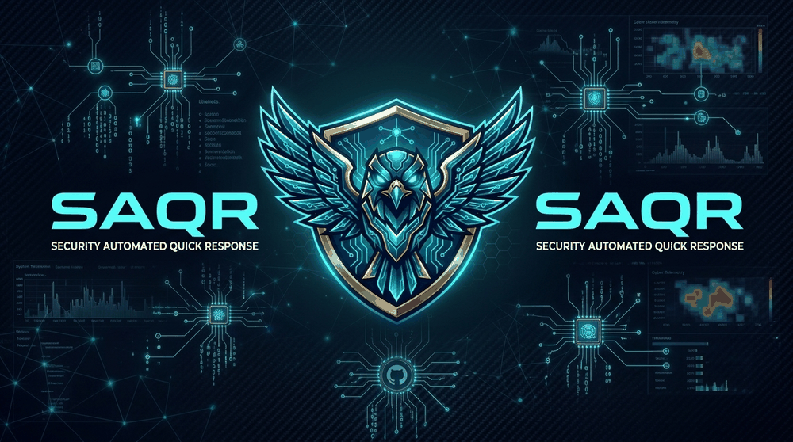
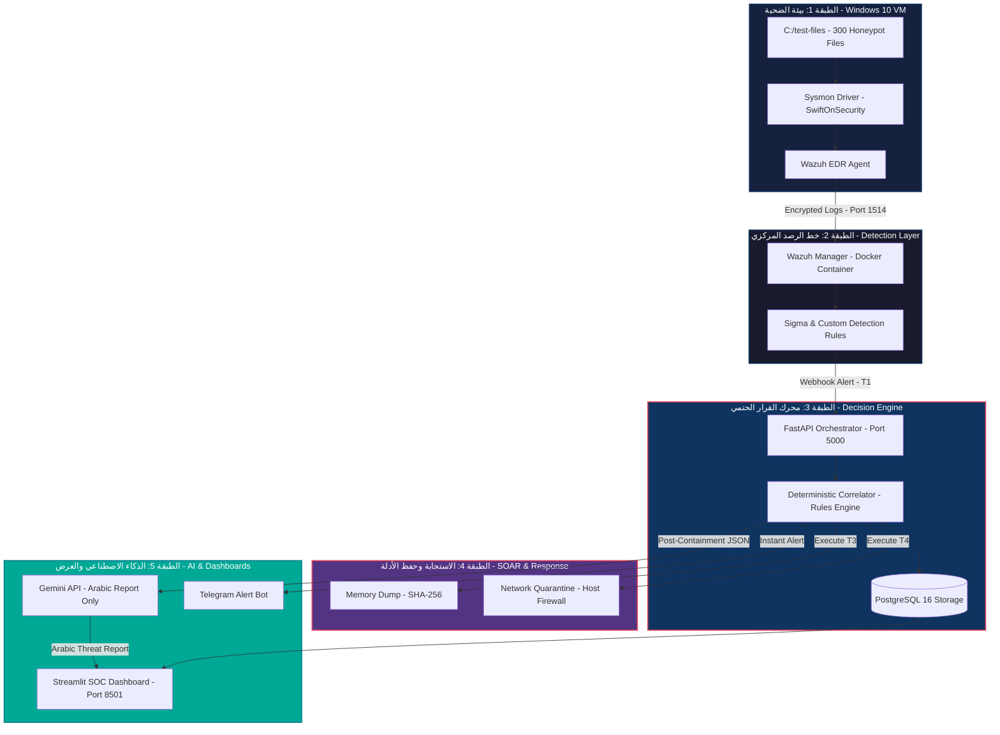
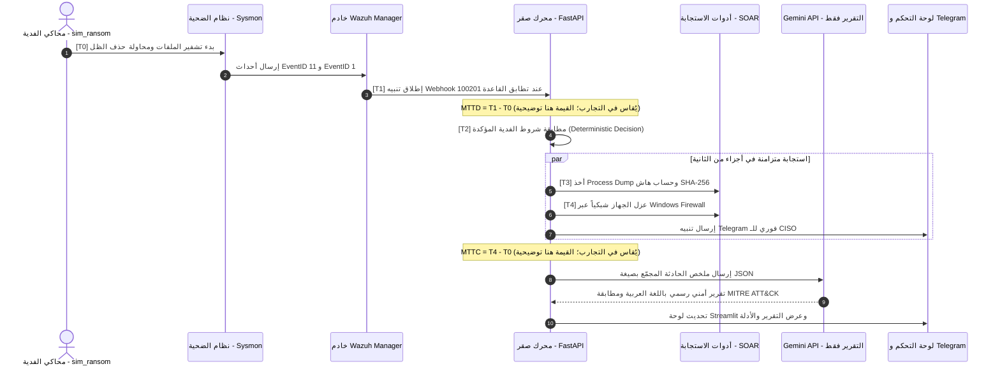

<p align="center">
  <a href="#-quick-start">
    
  </a>
</p>

<p align="center">
  <a href="#-quick-start"></a>
  <a href="#-tech-stack"></a>
  <a href="#-benchmarks"></a>
  <a href="#-gemini-api-only-التقارير-الذكية"></a>
  <a href="#-license"></a>
</p>

<p align="center">
  <b>منصة ذكية متكاملة للاستجابة الآلية للحوادث الأمنية بمركز عمليات مصغّر (Mini-SOC) ونواة استجابة حتمية (SOAR) مع طبقة تقارير ذكية تعتمد على Gemini API بعد تنفيذ الاستجابة الحتمية.</b>
</p>
<p align="center">
  <i>EDR-Grade Network Isolation · Volatile Memory Forensics (SHA-256) · Gemini API Reporting Only · MITRE ATT&CK Mapping · Arabic Threat Reports</i>
</p>
<p align="center">
  <code>DETECT</code> &nbsp;•&nbsp; <code>CONTAIN</code> &nbsp;•&nbsp; <code>EXPLAIN</code>
</p>

---

## 📑 فهرس المحتويات (Table of Contents)

1. [نظرة عامة والمشكلة التي نحلها](#-نظرة-عامة-والمشكلة-التي-نحلها)
2. [مصفوفة المقارنة](#-لماذا-صقر--مصفوفة-المقارنة)
3. [المعمارية خماسية الطبقات](#-المعمارية-خماسية-الطبقات)
4. [خط الاستجابة الزمني](#-خط-الاستجابة-الزمني-الحتمي)
5. [Gemini API حصرياً للتقارير الذكية](#-gemini-api-only-التقارير-الذكية)
6. [التقنيات المعتمدة](#-التقنيات-المعتمدة-tech-stack)
7. [السيناريوهات الدفاعية](#-السيناريوهات-الدفاعية-المدعومة)
8. [التشغيل السريع](#-التشغيل-السريع-في-5-دقائق)
9. [التقييم والتجارب الـ20](#-بروتوكول-التجارب-الـ-20-والتقييم-العلمي)
10. [هيكل المستودع](#-هيكل-المستودع-monorepo)
11. [الوثائق والمرفقات](#-وثائق-المشروع-والمرفقات)
12. [فريق العمل](#-فريق-العمل-والأدوار-الهندسية)
13. [القرارات المعتمدة](#-القرارات-المعتمدة-وتاريخ-التحديث)

---

## 📌 نظرة عامة والمشكلة التي نحلها

تعاني معظم المؤسسات المتوسطة والحكومية والقطاعات الحساسة (كالمصارف والمستشفيات) محلياً وإقليمياً من:
1. **شُح الكوادر الأمنية المتخصصة:** غياب فرق SOC و Incident Response مكرسة تعمل على مدار الساعة.
2. **الانتشار الكارثي للهجمات:** هجمات الفدية (Ransomware) تنتشر أفقياً عبر بروتوكولات الشبكة (مثل SMB) في دقائق معدودة قبل أن يلاحظ أي بشري.
3. **فقدان الأدلة الجنائية:** عند حدوث الاختراق، يتم فصل الأجهزة أو إعادة تشغيلها عشوائياً، مما يمحو الذاكرة المؤقتة (Volatile Memory) وآثار الجريمة.
4. **عزلة الحلول التجارية:** منصات SIEM و SOAR العالمية (مثل Splunk Phantom أو Cortex XSOAR) باهظة التكاليف، سحابية بالكامل وتتعارض مع قوانين سرية البيانات المحلية، ولا تدعم اللغة العربية.

### 💡 حل منصة صَقْر (SAQR Solution):
منصة دفاعية متكاملة ومفتوحة المصدر تجمع بين قدرات الـ **Mini-SOC** والمحاكاة والاستجابة الآلية الفورية **SOAR**:
* ⚡ **استجابة حتمية في أقل من 5 ثوانٍ:** عزل فوري للجهاز على مستوى جدار الحماية دون انتظار تدخل المحلل.
* 🛡️ **حفظ الأدلة الجنائية لحظياً:** التقاط تفريغ للذاكرة (Process Dump) وتوقيعه بهاش `SHA-256` قبل إنهاء العملية الخبيثة.
* 🤖 **تقارير Gemini API:** استخدام Gemini API لصياغة تحليل وتقرير عربي بعد انتهاء الاحتواء؛ لا يملك النموذج صلاحية اتخاذ قرار العزل أو تنفيذ أوامر.
* 🎯 **تكلفة واضحة:** مكونات الرصد والاستجابة مفتوحة المصدر، بينما يعتمد استخدام Gemini API على الحصة المتاحة أو تسعير حساب المشروع وقت التنفيذ.

---

## ⚡ لماذا صَقْر؟ — مصفوفة المقارنة

يعرض الجدول التالي أهداف التصميم المراد قياسها، وليس نتائج تجارب مكتملة:

| وجه المقارنة | الاستجابة التقليدية اليدوية | حلول SOAR التجارية | هدف SAQR في المختبر |
| :--- | :---: | :---: | :---: |
| **زمن الكشف (MTTD)** | يعتمد على المحلل | يعتمد على التهيئة | **هدف أقل من ثانيتين** |
| **زمن الاحتواء (MTTC)** | يتطلب تدخلاً يدوياً | يعتمد على الـ Playbook | **هدف أقل من 5 ثوانٍ** |
| **الملفات المتأثرة** | يختلف باختلاف الهجوم | يختلف باختلاف التهيئة | **قياس العدد قبل اكتمال العزل** |
| **الأدلة الجنائية** | قد تضيع عند إعادة التشغيل | تتطلب تهيئة وتكاملات | **جمع أدلة موثق مع SHA-256** |
| **العمل عند انقطاع الإنترنت** | يختلف حسب الأدوات | قد يتأثر بالخدمات السحابية | **الكشف والاحتواء محليان؛ تقارير Gemini والإشعارات تتأجل** |
| **التقارير العربية** | غالباً يدوية | بحسب المنتج والتكامل | **تقرير عربي بمساعدة Gemini API** |
| **التكلفة** | موارد بشرية وتشغيلية | تراخيص وخدمات | **مكونات مفتوحة المصدر مع احتمال تكلفة API** |

---

## 🏛️ المعمارية خماسية الطبقات

تم تصميم النظام على شكل معمارية معيارية متعددة الطبقات (Layered Modular Architecture) تضمن استقلالية خط الرصد عن محرك القرار وعن طبقة الذكاء الاصطناعي:



### تفاصيل الطبقات المعمارية:
1. **الطبقة 1 — بيئة الضحية المعزولة (Victim Environment):** آلة افتراضية Windows 10 معزولة على محول شبكة داخلي (VMware Workstation isolated VMnet)، مثبت عليها Sysmon بمخطط متقدم لمراقبة سلوك العمليات والملفات.
2. **الطبقة 2 — خط الرصد والتحليل (Detection Engine):** حاوية `wazuh-manager` الخفيفة المخصصة، تطبق قواعد Sigma وقواعد كشف مخصصة لاصطياد سلوك الفدية (مثل تكرار إعادة تسمية أكثر من 30 ملفاً في 5 ثوانٍ واستدعاء `vssadmin`).
3. **الطبقة 3 — محرك القرار الحتمي (FastAPI Core):** عقل المنظومة المسؤول عن استقبال تنبيهات الـ Webhook وربط الأحداث المتتالية (Correlation) وتسجيل الطوابع الزمنية الدقيقة (`T0` حتى `T4`).
4. **الطبقة 4 — الاستجابة المؤتمتة (Active Response & Forensics):** تشغيل متزامن لأخذ تفريغ الذاكرة للعملية وتجزئتها بـ `SHA-256` ثم تطبيق العزل الشبكي الكامل مع إبقاء الاتصال بخادم الإدارة فقط.
5. **الطبقة 5 — طبقة التحليل الذكي والتحكم (Intelligence & Dashboards):** توليد التقرير العربي بواسطة Gemini API بعد الاحتواء، وعرض الخط الزمني للحادثة على لوحة تحكم تفاعلية مع إرسال إشعار فوري لمدير الأمن عبر Telegram.

---

## ⏱️ خط الاستجابة الزمني الحتمي

> [!IMPORTANT]
> **القاعدة الذهبية لمنظومة صَقْر (The Golden Rule):**  
> **"الاستجابة حتمية برمجياً للسرعة + الذكاء الاصطناعي تحليلي بعد الاحتواء."**  
> قرار عزل الجهاز وحفظ الذاكرة لا ينتظر الـ LLM إطلاقاً؛ الكود ينفذ العزل في أجزاء من الثانية، بينما يتدخل الذكاء الاصطناعي **بعد انتهاء الاحتواء** للشرح والتوثيق.



---

## 🧠 Gemini API حصرياً للتقارير الذكية

اعتمدت الخطة الحالية **Gemini API فقط** لإنتاج التحليل والتقرير الأمني العربي. أُزيلت فكرة تشغيل نموذج محلي أو التبديل بين مزودين لتقليل استهلاك موارد الجهاز وتبسيط التنفيذ.

### حدود صلاحيات الذكاء الاصطناعي

- قرارات الكشف والارتباط وتحديد الخطورة والاحتواء تُنفذ بواسطة قواعد حتمية داخل SAQR.
- يُستدعى Gemini API بعد اكتمال الاستجابة، ويستقبل ملخصاً منظماً ومحدوداً للحادثة.
- يساهم Gemini في صياغة الملخص التنفيذي، والخط الزمني T0–T4، وشرح الأدلة، وربط المؤشرات بتقنيات MITRE ATT&CK، والتوصيات.
- لا يقرر Gemini عزل الجهاز، ولا ينفذ أوامر، ولا يغير قواعد الكشف أو سياسات الاستجابة.

### التعامل مع انقطاع الاتصال

الكشف والاحتواء وجمع الأدلة تستمر محلياً ولا تنتظر الإنترنت. عند تعذر Gemini API، تحفظ حالة التقرير بوصفها معلقة أو فاشلة مع تسجيل سبب الخطأ، ثم تعاد المحاولة عند عودة الاتصال. وبالمثل، لا يؤخر فشل Telegram الاستجابة؛ تحفظ الرسائل غير المرسلة لإعادة المحاولة.

**القيد المهم:** لا يمكن إنشاء تقرير Gemini جديد أثناء انقطاع الإنترنت. الاستمرار دون اتصال يشمل مسار الرصد والقرار والاستجابة المحلي، ولا يعني وجود نموذج AI محلي أو تقرير توليدي يعمل دون شبكة.

### الإعداد

المتغيرات المطلوبة هي مفتاح Gemini واسم نموذج متاح لحساب المشروع وقت التنفيذ. تحفظ المفاتيح في ملف محلي غير مرفوع إلى Git، ويوفر المستودع ملف إعداد نموذجي بقيم وهمية فقط.

---

## 🧰 التقنيات المعتمدة (Tech Stack)

| الطبقة | التقنية | الاستخدام |
|---|---|---|
| Virtualization | VMware Workstation | تشغيل Windows 10 VM في شبكة معزولة |
| Endpoint telemetry | Sysmon + Wazuh Agent | تسجيل أحداث النظام وإرسالها |
| Detection | Wazuh Manager + Rules | تصنيف التنبيهات وتوليدها |
| Runtime | Docker + WSL2 | تشغيل خدمات الخادم |
| Backend | Python + FastAPI | استقبال التنبيهات والتنسيق |
| Database | PostgreSQL | الحوادث والإجراءات والأدلة والتوقيتات |
| SOAR | Python Playbooks | جمع الأدلة والعزل |
| AI Reporting | Gemini API only | صياغة التقرير بعد الاحتواء |
| Dashboard | Streamlit RTL | متابعة الحوادث والمقاييس والتقارير |
| Notifications | Telegram Bot | التنبيه الفوري وإرسال التقارير |
| Framework | MITRE ATT&CK | تصنيف التقنيات والسلوكيات |

## 🛡️ السيناريوهات الدفاعية المدعومة

```
┌──────────────────────────────────────────────────────────────────────────────┐
│  السيناريوهات التشغيلية لمنظومة صَقْر                                        │
├──────────────────────────────────────────────────────────────────────────────┤
│  🔴 1. هجوم برامج الفدية (Ransomware Outbreak) — [نجم المشروع / سيمستر 1]   │
│     • المحاكاة: تشفير ملفات Honeypot بسرعة عالية + استدعاء vssadmin.         │
│     • الرصد: مراقبة وتيرة التعديل وربط الأحداث المشبوهة عبر Sysmon/Wazuh.     │
│     • الاستجابة: Process Dump + عزل جدار الحماية + تقرير عربي + MTTD < 2s.   │
├──────────────────────────────────────────────────────────────────────────────┤
│  🟡 2. التصيد الاحتيالي المستهدف (Targeted Phishing) — [سيمستر 2]             │
│     • المحاكاة: رسائل تصيد بريدية عبر GoPhish مع صفحات دخول مزيفة Look-alike.│
│     • الرصد: كشف الاتصال بالنطاق الخبيث وإلغاء الجلسات النشطة.              │
│     • الاستجابة: حظر النطاق على مستوى الجدار الناري وحساب مؤشرات الوعي.     │
├──────────────────────────────────────────────────────────────────────────────┤
│  🟠 3. حجب الخدمة الموزع (DDoS Flooding) — [سيمستر 2]                       │
│     • المحاكاة: هجوم إغراق مروري موزع على خادم الويب التجريبي.               │
│     • الرصد والذكاء: تمييز الهجوم الفعلي عن ذروة الاستخدام الطبيعية (AI).    │
│     • الاستجابة: تطبيق Rate Limiting ديناميكي وحظر عناوين IP المهاجمة.       │
└──────────────────────────────────────────────────────────────────────────────┘
```

---

## 🚀 التشغيل السريع في 5 دقائق

### 1. المتطلبات الأساسية (Prerequisites)
* نظام تشغيل **Windows 10/11** مع تثبيت **VMware Workstation** وميزة **WSL2**. خصص شبكة VMware افتراضية معزولة (Host-only أو Custom VMnet) للآلة التجريبية.
* تثبيت **Docker Desktop** مفعل عليه محرك WSL2.
* ذاكرة وصول عشوائي (RAM) لا تقل عن **16GB**، ومساحة قرص خالية **60GB**.

### 2. إعداد تقييد ذاكرة WSL2 (إلزامي لمنع استنزاف الجهاز)
أنشئ ملفاً باسم `.wslconfig` داخل مسار المستخدم الرئيسي `C:\Users\<Your-Username>\.wslconfig`:
```ini
[wsl2]
memory=4GB
processors=4
swap=2GB
localhostForwarding=true
networkingMode=mirrored
```

### 3. استنساخ المستودع وبدء التشغيل
```bash
# 1. استنساخ المستودع
git clone https://github.com/omar123JR/SAQR.git
cd SAQR

# 2. إعداد المتغيرات البيئية
cp .env.example .env
# أدخل GEMINI_API_KEY وGEMINI_MODEL فقط؛ لا يوجد إعداد لمزود AI محلي

# 3. تشغيل كافة الخدمات عبر Docker Compose
docker compose -f deploy/docker-compose.yml up -d
```

### 4. الروابط المباشرة بعد التشغيل:
* 🌐 **لوحة تحكم Mini-SOC (Streamlit):** `http://localhost:8501`
* 🔌 **واجهة المحرك التفاعلية (FastAPI Swagger Docs):** `http://localhost:5000/docs`
* 📡 **مدير المراقبة (Wazuh API):** `https://localhost:55000`

---

## 📊 بروتوكول التجارب الـ 20 والتقييم العلمي

تُنفذ **20 تجربة قياسية** مع استعادة لقطة Windows 10 النظيفة قبل كل تشغيل. لا تُعرض النتائج قبل تنفيذ التجارب وجمعها فعلياً.

| المقياس | هدف التقييم | القيمة الفعلية |
|---|---:|---|
| متوسط زمن الكشف MTTD | أقل من 2 ثانية | يملأ بعد التجارب |
| متوسط زمن الاحتواء MTTC | أقل من 5 ثوانٍ | يملأ بعد التجارب |
| عدد الملفات المتأثرة قبل العزل | أقل ما يمكن | يسجل في كل تجربة |
| انتشار النشاط خارج الآلة التجريبية | صفر أجهزة | يتحقق ويثبت عملياً |
| نسبة الإنذارات الكاذبة | تقاس مع أنشطة سليمة | يملأ بعد التجارب |
| جودة التقرير العربي | تقييم بشري/معياري | يملأ بعد التقييم |

يجب حساب المتوسط والوسيط والانحراف المعياري والحدين الأدنى والأقصى، مع توثيق حالات الفشل والإنذارات الكاذبة. أرقام الأداء الواردة في الرسومات أو أمثلة لوحة التحكم هي قيم توضيحية وليست قياسات معتمدة.

---

## 📁 هيكل المستودع (Monorepo)

```
saqr/
├── README.md                       # الوثيقة التعريفية الرئيسية
├── .gitignore                      # استثناء ملفات النظام والبيئات المؤقتة
├── deploy/
│   └── docker-compose.yml          # حاويات Wazuh, Engine, DB, Dashboard
├── files/                          # الوثائق الرسمية والمقترحات المعتمدة
│   ├── SAQR-Master-Plan.pdf        # نسخة الخطة السابقة
│   ├── SAQR-Project-Explainer.pdf  # العرض التقديمي الأولي للمشروع
│   └── Proposal/
│       └── Project_Proposal_SAQR (1).pdf # وثيقة مقترح التخرج المعتمدة
├── lab/                            # بيئة المختبر وسيناريوهات الهجوم
│   ├── vms/                        # إعدادات وسكريبتات الآلات الافتراضية
│   └── attack-engine/
│       └── ransomware-sim/
│           └── sim_ransom.py       # محاكي الفدية الآمن داخل Honeypot
├── detection/                      # إعدادات الرصد وقواعد الكشف
│   ├── sysmon/                     # تكوين Sysmon لمراقبة العمليات
│   └── wazuh/rules/                # قواعد الكشف السلوكي الخاصة بصقر
├── ai/\n│   └── gemini_client.py            # تكامل Gemini API حصرياً\n├── engine/                         # محرك القرار الحتمي (FastAPI Core)
│   ├── app/
│   │   ├── main.py                 # واجهات استقبال التنبيهات
│   │   ├── correlator.py           # خوارزميات ربط الأحداث المتتالية
│   │   └── services/
│   │       ├── soar.py             # تنسيق العزل وتفريغ الذاكرة
│   │       └── gemini.py           # عميل Gemini API للتقارير فقط
├── dashboard/                      # لوحة التحكم التفاعلية (Streamlit RTL)
└── metrics/                        # سكريبتات القياس وجداول الـ 20 تشغيلة
```

---

## 📄 وثائق المشروع والمرفقات

كافة وثائق المشروع الهندسية متاحة داخل مجلد `files/`:

* 📄 **[SAQR-Master-Plan.pdf](files/SAQR-Master-Plan.pdf):** نسخة الخطة السابقة الموجودة حالياً في المستودع. النسخة المحدّثة من الخطة مرفقة بشكل منفصل إلى حين رفعها إلى مجلد `files/`.
* 📊 **[SAQR-Project-Explainer.pdf](files/SAQR-Project-Explainer.pdf):** العرض البصري التعريفي بالمنصة والقواعد الهندسية الذهبية.
* 📝 **[Project_Proposal_SAQR.pdf](files/Proposal/Project_Proposal_SAQR%20(1).pdf):** المقترح الأكاديمي المبدئي لمشروع التخرج.
* 🎨 **[Official Brand Assets](files/saqr-banner.png):** الهوية البصرية الرسمية للمنصة — [الشعار الكامل (Banner)](files/saqr-banner.png) | [أيقونة التطبيق (App Icon)](files/saqr-icon.png) | [رمز الشعار (Emblem)](files/saqr-logo.png).

---

## 👥 فريق العمل والأدوار الهندسية

مشروع تخرج لدرجة البكالوريوس في **هندسة الأمن السيبراني** — فريق مكون من 5 مهندسين:

| المهندس / المسؤول | الدور الوظيفي | نطاق المسؤولية التقنية |
| :--- | :--- | :--- |
| **مهندس المعمل والمحاكاة** | Lab & Simulation Engineer | إعداد VMware Workstation و Windows 10 VM، وبرمجة محاكي الفدية، وإدارة اللقطات النظيفة. |
| **مهندس الرصد واكتشاف التهديدات** | Detection Engineer | ضبط حاوية Wazuh Manager وتكوين Sysmon وصياغة قواعد Sigma لاصطياد الهجمات. |
| **مهندس محرك القرار وقواعد البيانات** | Core Engine & DB Dev | بناء محرك FastAPI وخوارزميات Correlation وحساب التوقيتات T0..T4 على PostgreSQL. |
| **مهندس الاستجابة والذكاء الاصطناعي** | SOAR & AI Engineer | أتمتة سكريبتات العزل و Process Dump، وتكامل Gemini API للتقارير فقط بعد الاحتواء. |
| **مسؤول لوحة التحكم والتقييم العلمي** | Dashboard & Evaluation Lead | تطوير لوحة Streamlit العربية، وبوت Telegram، وإدارة جلسات قياس الـ 20 تجربة. |

---


---

## 🧾 القرارات المعتمدة وتاريخ التحديث

| العنصر | القرار الحالي |
|---|---|
| Virtualization | VMware Workstation بدلاً من Hyper-V |
| AI | Gemini API فقط؛ لا Ollama أو Qwen أو نموذج محلي أو Hybrid Provider |
| Notifications | Telegram Bot؛ لا Email أو SMTP في النطاق الحالي |
| Response authority | المحرك الحتمي المحلي يقرر وينفذ العزل وجمع الأدلة؛ Gemini للتفسير والتقرير فقط |
| Internet failure | تستمر الاستجابة المحلية؛ وتؤجل تقارير Gemini وإشعارات Telegram حتى عودة الاتصال |

تم تحديث الخطة بتاريخ **9 نوفمبر 2026**. تعتمد تسمية SAQR في وثيقة الخطة الأصلية على **Security Automated Query & Response**.

## 🤝 Contributors

| Contributor | GitHub | Contribution |
|---|---|---|
| **Sanad Eltaif** | [@sanad-eltaif](https://github.com/sanad-eltaif) | README documentation update, architecture alignment, and project-plan documentation |

> GitHub also calculates the repository's contributor graph from commits authored by linked GitHub accounts. Documentation commits are authored using the connected `sanad-eltaif` account.

---

<p align="center">
  <b>صُمم وطُوّر بكل فخر كحل سيبراني دفاعي مفتوح المصدر 🦅</b>
  <br />
  <sub>SAQR Platform — Security Automated Query & Response © 2026</sub>
</p>
