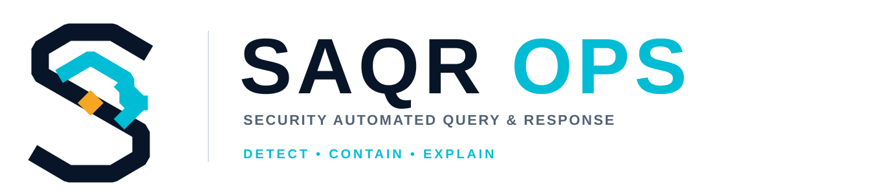

# SAQR | Brand Identity & Logo Rationale

> **Document:** Brand identity rationale and usage guide  
> **Project:** SAQR — Security Automated Query & Response  
> **Current wordmark:** SAQR OPS  
> **Tagline:** DETECT • CONTAIN • EXPLAIN  
> **Version:** 1.0  
> **Prepared:** 10 November 2026  
> **Status:** Proposed visual system for the academic project and future product direction

<p align="center"></p>

---

## 1. Purpose of this document

This document records why the SAQR identity looks the way it does, how the project itself informed the logo, which real cybersecurity brands and products were reviewed, and how contributors should use the assets consistently.

The goal is not to imitate another cybersecurity company. The goal is to build a recognizable identity that fits SAQR's real engineering role today and still makes sense if the project becomes a product in the future.

The root `README.md` remains the project's technical introduction. This document lives separately in `docs/brand/` so that branding decisions can evolve without mixing them into the main technical overview.

## 2. Understanding the product before designing the identity

The design was based on the current project description in the repository's `README.md`, not on a generic assumption about what a cybersecurity tool does.

SAQR is a defensive Mini-SOC and SOAR platform. The repository describes a workflow with five main stages:

1. **Collect and monitor:** Sysmon and the Wazuh Agent collect endpoint telemetry from the isolated Windows lab machine.
2. **Detect:** Wazuh Manager applies detection rules and produces security alerts.
3. **Correlate and decide:** The SAQR FastAPI engine correlates events and applies deterministic response logic.
4. **Respond and preserve evidence:** The response layer captures process memory evidence, records a SHA-256 hash, and isolates the affected host through its firewall.
5. **Explain and report:** Gemini API is used after containment to help produce an Arabic incident report. It is not the authority that decides whether to isolate a host or executes the containment action. The dashboard and Telegram integration present or communicate incident information.

The product's defining idea is therefore a controlled security workflow:

**Detect → Correlate → Preserve → Contain → Explain**

This is important to the identity. SAQR is not simply an antivirus, a bird mascot, a firewall, or a generic AI chatbot. It is a coordinated incident-response workflow with a clear separation between deterministic response and post-incident AI reporting.

> **Engineering distinction:** The performance figures in the README are evaluation targets until they are supported by completed experiments. The logo and this brand document do not present those targets as proven product results.

## 3. Name and brand architecture

### 3.1 Official project name

**SAQR — Security Automated Query & Response**

This is the expansion currently documented in the repository. The short name SAQR is retained as the primary identity because it is compact, memorable, and connected to the project's Arabic name, صقر.

### 3.2 Current visual wordmark

**SAQR OPS**

The current repository banner already uses the SAQR OPS lockup. In this identity system, **SAQR** is the core project and brand name, while **OPS** is a product descriptor that signals security operations.

The addition of OPS does not replace the official project expansion or rename the academic project.

### 3.3 Tagline

**DETECT • CONTAIN • EXPLAIN**

The tagline compresses the product experience into three user-facing promises:

- **DETECT:** identify suspicious activity from endpoint and security telemetry.
- **CONTAIN:** execute the approved deterministic response and preserve evidence.
- **EXPLAIN:** make the incident understandable through a structured report and supporting context.

The three words are intentionally short. They communicate the platform's role to a SOC analyst, a technical evaluator, and a potential customer without requiring a long technical description.

### 3.4 Future commercial naming

If SAQR is commercialized, a practical naming structure is:

| Level | Suggested name | Purpose |
|---|---|---|
| Brand | **SAQR** | Umbrella identity and company/product family |
| Main platform | **SAQR OPS** | The Mini-SOC and SOAR platform |
| Optional modules | SAQR Detect, SAQR Respond, SAQR Intel, SAQR Reports | Names for separately packaged capabilities if they are implemented |

These module names are naming proposals, not a claim that separate products already exist.

Before commercial launch, the team should check trademark registers in intended markets, domain availability, social handles, and confusingly similar names. This document is not a legal trademark clearance.

## 4. Logo concept and design philosophy

### 4.1 The symbol: a geometric S and a response route

The emblem is an abstract, angular **S**. It is designed to work as a distinctive software mark rather than a literal illustration of an animal, shield, lock, or hacker.

The S is built from a continuous, structured route. This supports several readings that fit the product:

- **SAQR:** the first letter of the brand name.
- **Security workflow:** the route represents an event moving through a controlled process.
- **Orchestration:** the route connects a signal to an action instead of suggesting a single isolated security feature.
- **Systematic response:** the geometric construction gives the mark an engineered and repeatable character.

### 4.2 The cyan route and arrow

The cyan element crosses the S and finishes in a directional arrow. It represents the movement from detection toward response.

It is associated with:

- telemetry and data flow;
- correlation and orchestration;
- automated response;
- a clear direction of action.

The arrow is deliberately integrated into the letterform. It is not an additional decorative icon.

### 4.3 The amber diamond

The small amber diamond is the incident or trigger point in the workflow.

It represents the moment where a signal is treated as an event that needs attention. Amber was selected because it reads as an alert or status accent without making the entire identity look like an emergency warning.

It is a visual metaphor, not a claim that every amber state in the product UI must have a particular technical severity.

### 4.4 Why there is no literal falcon or shield

The Arabic project name already carries the falcon association. Repeating a detailed falcon head, talons, or shield in the logo would make the brand more illustrative and could push it toward a military-unit or gaming identity.

The abstract S keeps the name's identity while making the mark appropriate for:

- a professional SOC dashboard;
- a software application icon;
- technical reports and academic documents;
- a website or future commercial product;
- monochrome printing and small UI placements.

The falcon remains part of the verbal story of the name. It does not need to be drawn literally in every brand asset.

## 5. Color system

The vector assets use a compact palette aligned with the colors already present in the repository's README badges and existing SAQR artwork.

| Color | Hex | Role |
|---|---|---|
| **SAQR Navy** | `#081528` | Main structure, wordmark, trust, technical depth |
| **Response Cyan** | `#00BCD4` | Route, response arrow, active interaction |
| **Signal Amber** | `#F5A623` | Incident point and selective attention accent |
| **Slate** | `#536275` | Supporting descriptor and secondary text |
| **Divider Gray** | `#D7DEE8` | Quiet separators on light layouts |
| **White** | `#FFFFFF` | Clear space or light-background presentation, not a baked-in SVG background |

### Color behavior

- Navy carries the main brand weight.
- Cyan should identify the response route and active elements, not be applied to every piece of text.
- Amber is a limited accent. Large amber backgrounds or excessive amber text weaken its alert meaning.
- Slate and divider gray are supporting colors, not alternatives to the main palette.
- The logo artwork itself contains no background rectangle. Its background is transparent.

## 6. Typography

The SVG wordmark currently uses a bold sans-serif stack (`Arial, Helvetica, sans-serif`) so it remains broadly viewable without depending on a bundled font file.

For future SAQR interface and document design, a consistent pairing is recommended:

- **Latin interface and headings:** Inter or a similar neutral sans-serif.
- **Arabic interface and body text:** IBM Plex Sans Arabic or a similarly legible Arabic sans-serif.
- Use a clear weight hierarchy: bold for page titles, semibold for section labels, and regular for long descriptions.

These are recommendations for the wider product design system. They do not change the font stack embedded in the current SVG files.

## 7. What was reviewed: real cybersecurity companies and products

The reference review separates **brand identity references** from **product-category competitors**. A company can be useful as a brand-design reference without being a direct one-to-one competitor to SAQR.

### 7.1 Wazuh — open-source security platform and ecosystem reference

**Why it matters to SAQR:** Wazuh is part of the current technical stack described in the repository. It is not simply an external logo reference; its agent, server, rules, and monitoring role are part of the product context.

**What was reviewed:**
- Wazuh's public explanation of its platform and its endpoint, SIEM, XDR, and incident-response capabilities.
- Wazuh's own 2022 rebranding announcement, which explains why the organization moved to a cleaner and simpler identity as the platform grew.

**What SAQR takes from the study:**
- An open-source security product needs an identity that feels credible and maintainable, not temporary or experimental.
- A simple symbol and consistent colors work better across dashboards, docs, community pages, and downloads.
- The identity should represent the whole platform, not one integrated component such as Wazuh.

**What SAQR does not copy:** Wazuh's logo, animal association, exact shapes, or proprietary graphic assets.

References:
- [Wazuh platform overview](https://wazuh.com/platform/overview/)
- [Wazuh rebranding announcement, 6 May 2022](https://wazuh.com/blog/wazuh-rebranding-announcement/)

### 7.2 Tines — security automation and workflow reference

**Why it matters:** Tines operates in the security-automation space. Its public brand story explains how the team wanted its identity to communicate both technical capability and an approachable product experience.

**What was reviewed:**
- Tines' explanation of its brand refresh and its decision to soften the logo and use a warmer typeface.
- Its published brand system, including the way it uses color, layouts, visual elements, and logo rules.

**What SAQR takes from the study:**
- Security automation should feel understandable to the people who operate it.
- A product identity benefits from a consistent system beyond the logo itself.
- The visual language should support workflow and orchestration without filling every surface with security clichés.

**What SAQR does not copy:** Tines' logo, typography, dot patterns, layouts, or proprietary assets.

References:
- [Tines: Introducing our new website and brand](https://www.tines.com/blog/a-new-look-for-tines/)
- [Tines brand system](https://live.standards.site/tines-brand/system)
- [Tines newsroom and official brand assets](https://www.tines.com/newsroom/)

### 7.3 Cortex XSOAR — incident-response product benchmark

**Why it matters:** Cortex XSOAR is a useful product-category benchmark because it documents incident management, automation packs, playbooks, investigation workflows, threat intelligence, and post-incident reporting.

**What SAQR takes from the study:**
- The brand must communicate an operational platform, not only a detection engine.
- The visual identity should remain clear when used around playbooks, incident timelines, evidence, and response actions.

**What SAQR does not copy:** Cortex XSOAR's product marks, interface, visual components, or proprietary assets.

Reference:
- [Palo Alto Networks Cortex XSOAR](https://www.paloaltonetworks.com/cortex/cortex-xsoar)

### 7.4 Splunk SOAR — orchestration and workflow benchmark

**Why it matters:** Splunk's SOAR material describes orchestration across security tools, customizable playbooks, automated actions, and case management. Those are useful category concepts when explaining SAQR's own orchestration role.

**What SAQR takes from the study:**
- Explain the platform through an operational sequence and its outcomes.
- Give the product identity enough flexibility to cover integrations, playbooks, dashboards, and reporting.

**What SAQR does not copy:** Splunk's trademarks, logo, interface, or proprietary assets.

References:
- [Splunk SOAR product page](https://www.splunk.com/en_us/products/splunk-security-orchestration-and-automation.html)
- [Splunk SOAR documentation](https://help.splunk.com/en/splunk-soar)

### 7.5 SentinelOne — visual identity system reference

**Why it matters:** SentinelOne publishes a formal brand-guidelines page and a logo package. This demonstrates the importance of treating the logo as a managed asset with rules, not as a single image copied wherever needed.

**What SAQR takes from the study:**
- Keep approved variants in one known location.
- Define how the full logo and standalone symbol are used.
- Avoid ad hoc recoloring, stretching, and reconstruction.

**What SAQR does not copy:** SentinelOne's logo, colors, shapes, or proprietary brand files.

Reference:
- [SentinelOne brand guidelines and logo package](https://www.sentinelone.com/brand-n/)

### 7.6 CrowdStrike — brand governance reference

**Why it matters:** CrowdStrike makes its brand guide and multiple logo formats available through its official brand page. Its brand identity PDF explains a broader system rather than treating the logo as a standalone mark.

**What SAQR takes from the study:**
- Maintain one source of truth for current logos.
- Provide suitable variants for different backgrounds and contexts.
- Document consistent use for contributors, presentations, and commercial materials.

**What SAQR does not copy:** CrowdStrike's falcon symbol, typography, color identity, or proprietary artwork.

References:
- [CrowdStrike official brand guide](https://www.crowdstrike.com/en-us/about-us/brand/)
- [CrowdStrike Brand Identity Guidelines, 2025 PDF](https://www.crowdstrike.com/content/dam/crowdstrike/marketing/en-us/documents/pdfs/brand/CrowdStrike-Brand-ID-2025.pdf)

### 7.7 Lessons from the reference review

| Observation | Decision for SAQR |
|---|---|
| Security products need clarity at small sizes | Use an independent geometric emblem |
| Automation products need to communicate flow | Integrate a route and arrow into the S |
| Incident response needs a recognizable event cue | Use one amber signal node |
| Open-source products need consistent assets | Store the canonical SVG files in the repository |
| Mature brands document their visual rules | Keep this rationale and usage guide beside the assets |
| Enterprise products appear across many surfaces | Provide full, compact, inverse, and monochrome-ready variants |

This is a design study, not a claim that SAQR has the same scale, feature depth, maturity, or market position as the referenced companies.

## 8. Logo files and approved variants

The source files are stored in `docs/brand/assets/`.

| Asset | File | Intended use |
|---|---|---|
| Primary lockup | [saqr-primary.svg](assets/saqr-primary.svg) | Main identity on light or transparent backgrounds |
| Inverse lockup | [saqr-primary-inverse.svg](assets/saqr-primary-inverse.svg) | Main identity on dark backgrounds |
| Standalone mark | [saqr-mark.svg](assets/saqr-mark.svg) | App icon source, favicon source, compact placements |
| Inverse standalone mark | [saqr-mark-inverse.svg](assets/saqr-mark-inverse.svg) | Standalone mark on dark backgrounds |

### Why SVG

SVG is a vector format. It keeps the edges sharp at large sizes and small sizes, is lightweight for a simple mark, and does not require a white or colored canvas behind the logo.

The current SVG artwork:
- has no background rectangle;
- uses transparent space around the paths;
- includes accessible title and description metadata;
- uses the same color palette across the logo family;
- can be resized without raster pixelation.

The wordmark uses a system sans-serif font stack. For a future print master, the team should also export an outlined-text version from a vector editor to eliminate any font-rendering differences.

## 9. Usage rules

### Clear space

Keep an empty area around the complete logo. As a practical minimum, leave clear space equal to the width of the amber diamond on every side of the lockup. For the standalone mark, use at least one eighth of the mark's width.

### Minimum size

- Full primary lockup: recommended minimum width **360 px** in digital layouts.
- Standalone mark: recommended minimum width **28 px** in digital interfaces.
- For very small use, use the standalone mark rather than shrinking the full lockup and making its descriptor unreadable.

### Backgrounds

- Use `saqr-primary.svg` on light backgrounds.
- Use `saqr-primary-inverse.svg` on dark navy or similarly dark backgrounds.
- Use the standalone mark when space is constrained.
- Because the SVG background is transparent, the surface behind it shows through.

### Do not

- Stretch, compress, rotate, or skew the logo.
- Change the cyan, navy, or amber values without a documented brand revision.
- Add bevels, 3D effects, shadows, gradients, glows, or outlines.
- Place the logo over a noisy image or low-contrast surface.
- Rebuild the wordmark by typing a different font and spacing.
- Separate the amber diamond from the S and use it as an unrelated decorative badge.
- Add a falcon, shield, lock, or other extra symbol to the approved lockup.

## 10. Using the logo in Markdown and project materials

From the repository root, a future page can embed the primary logo with a relative path:

```html
<p align="center">
  
</p>
```

Within a Markdown document located in `docs/brand/`, use:

```markdown

```

The root README has not been modified as part of this branding update. This document is intentionally independent from the README.

## 11. Brand voice and product language

The visual identity is supported by a simple communication style:

- **Precise:** describe observed events, evidence, actions, and timestamps.
- **Calm:** avoid alarmist language in dashboards and reports.
- **Operational:** explain what was detected, what the response engine did, and what remains for the analyst.
- **Transparent:** distinguish automated actions from AI-generated explanation.
- **Bilingual where useful:** keep technical names and standards recognizable while providing clear Arabic explanations.

Preferred product sentence:

> **SAQR detects suspicious activity, preserves evidence, contains affected endpoints through deterministic response logic, and helps analysts understand incidents through structured reporting.**

Avoid claims such as “AI autonomously stops every attack” or “zero spread guaranteed.” Product claims must be supported by documented tests.

## 12. Research approach and source policy

The visual research used publicly accessible official material from the companies listed above:

1. Review official product descriptions to understand the product category and workflow.
2. Review official brand announcements and brand-guideline pages to understand how each company manages its identity.
3. Extract general design lessons such as simplicity, consistency, legibility, and variant control.
4. Develop an original SAQR symbol based on the project's own name and workflow.
5. Store original vector files in the repository and document their intended use.

No third-party logo artwork, screenshots, brand packages, or proprietary graphic elements are embedded in the SAQR logo files. Company names and links are used for attribution and comparative research only.

## 13. Future work before commercial release

The current assets establish a coherent working identity. Before selling or distributing SAQR as a commercial product, the team should complete the following:

- Trademark and business-name clearance in each target market.
- Domain and social-handle availability checks.
- A final vector review by a brand designer.
- An outlined-text master and export set: SVG, PDF, PNG, and favicon.
- Light and dark product UI themes using the same palette.
- Accessibility checks for text and interactive color contrast.
- A license and ownership review for all fonts, icons, libraries, and third-party assets used in the product.
- A final review of product naming and claims against the implemented features and test results.

---

## Sources

All sources below are public company pages or official product/brand materials. Accessed 10 November 2026.

1. Wazuh, [Platform overview](https://wazuh.com/platform/overview/).
2. Wazuh, [Rebranding announcement, 6 May 2022](https://wazuh.com/blog/wazuh-rebranding-announcement/).
3. Tines, [Introducing our new website and brand](https://www.tines.com/blog/a-new-look-for-tines/).
4. Tines, [Official brand system](https://live.standards.site/tines-brand/system).
5. Tines, [Newsroom and brand assets](https://www.tines.com/newsroom/).
6. Palo Alto Networks, [Cortex XSOAR](https://www.paloaltonetworks.com/cortex/cortex-xsoar).
7. Splunk, [Splunk SOAR](https://www.splunk.com/en_us/products/splunk-security-orchestration-and-automation.html).
8. Splunk, [SOAR documentation](https://help.splunk.com/en/splunk-soar).
9. SentinelOne, [Brand guidelines](https://www.sentinelone.com/brand-n/).
10. CrowdStrike, [Official brand guide](https://www.crowdstrike.com/en-us/about-us/brand/).
11. CrowdStrike, [Brand Identity Guidelines, 2025](https://www.crowdstrike.com/content/dam/crowdstrike/marketing/en-us/documents/pdfs/brand/CrowdStrike-Brand-ID-2025.pdf).

---

**SAQR — Security Automated Query & Response**  
*DETECT • CONTAIN • EXPLAIN*
